# fabric-am-energy

[](https://github.com/v-nc/fabric-am-energy/actions/workflows/ci.yml)

Energy monitoring for a park of laser-sintering 3D printers, built end to end in Microsoft Fabric: OPC UA at the
edge, streaming ingestion, a bronze/silver/gold Lakehouse, a Direct Lake semantic model and a Power BI report, all
versioned in this repository.

> **What this is.** A personal portfolio project on **simulated data**, inspired by an energy-monitoring project I
> built in 2019 (an OPC UA aggregation client, InfluxDB and Grafana, with alerts on 3D printers left in an over-long
> heat-up). No real machine, customer or company data is used. Every power and timing parameter is an assumption,
> listed in [`config/assumptions.yaml`](config/assumptions.yaml). The one exception is public: the day-ahead market
> prices on the market-price page are real (Energy-Charts; data Bundesnetzagentur | SMARD.de,
> [CC BY 4.0](https://creativecommons.org/licenses/by/4.0/)).
>
> Microsoft Fabric DP-700 (Fabric Data Engineer Associate): in preparation.

[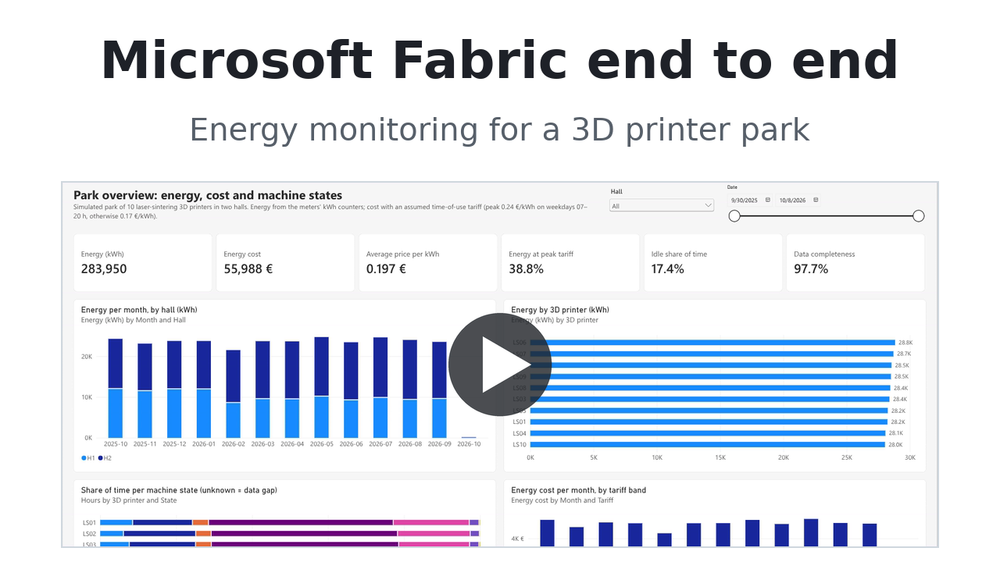](https://www.youtube.com/watch?v=nlJAalXInHI)

**[Demo video (3:53)](https://www.youtube.com/watch?v=nlJAalXInHI)**, with captions: the system running live, from the
OPC UA edge through the real-time dashboard and alert to the nightly pipeline, the report, Git and CI.

## At a glance

- **Edge:** an OPC UA server simulates 10 3D printers in two halls with their energy meters. A TypeScript gateway
  subscribes, buffers in SQLite (store-and-forward) and streams to Fabric over the Event Hubs protocol.
- **Fabric:** Eventstream → Lakehouse (bronze, silver, gold) → Direct Lake semantic model → six-page Power BI report,
  orchestrated by a daily pipeline with table maintenance, on a paid F4 capacity that is paused when idle.
- **Real time:** the same Eventstream feeds an Eventhouse. KQL functions drive a Real-Time Dashboard and Activator
  e-mail alerts: one per heat-up overrun (the 2019 alert, live) and one per failed run of the daily pipeline.
- **Market prices:** a Dataflow Gen2 loads public Swiss day-ahead prices into a Warehouse, where a T-SQL procedure
  joins them with gold; the mart reaches the report through a OneLake shortcut.
- **Engineering:** transformations are a tested Python package deployed to Fabric as a wheel; 67 automated tests run
  on GitHub Actions at every push; every Fabric item but the Activator, including the semantic model and the report,
  is stored here as text through Git integration; 44 [design decisions](docs/decisions.md) are written down.
- **Checked against the truth:** the simulator injects faults and records them in a ground-truth file. The pipeline
  removed exactly the 10,522 injected duplicates, found 100 of 108 injected heat-up overruns with no false alarm, and
  reports 97.7 % data completeness.

## Report

| | |
|---|---|
| [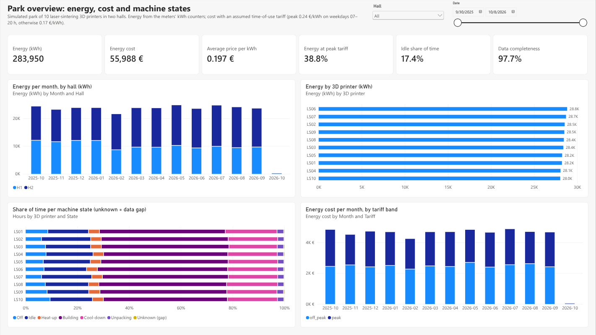](docs/screenshots/01-park-overview.png) **Park overview:** energy, cost and machine states | [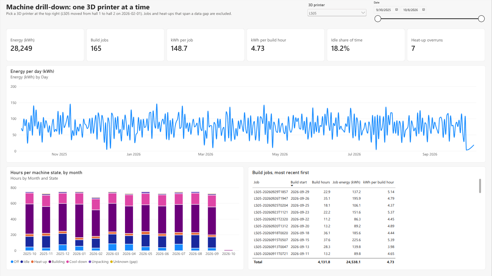](docs/screenshots/02-machine-drill-down.png) **Machine drill-down:** one 3D printer at a time |
| [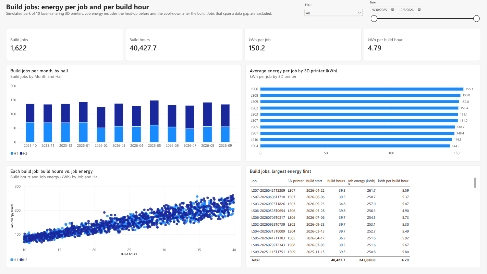](docs/screenshots/03-build-jobs.png) **Build jobs:** energy per job and per build hour | [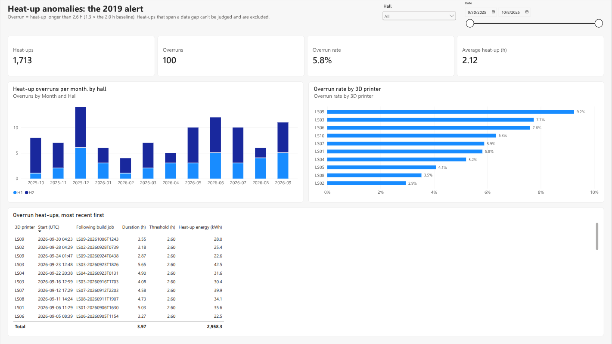](docs/screenshots/04-heat-up-anomalies.png) **Heat-up anomalies:** the 2019 alert, recomputed over a year |
| [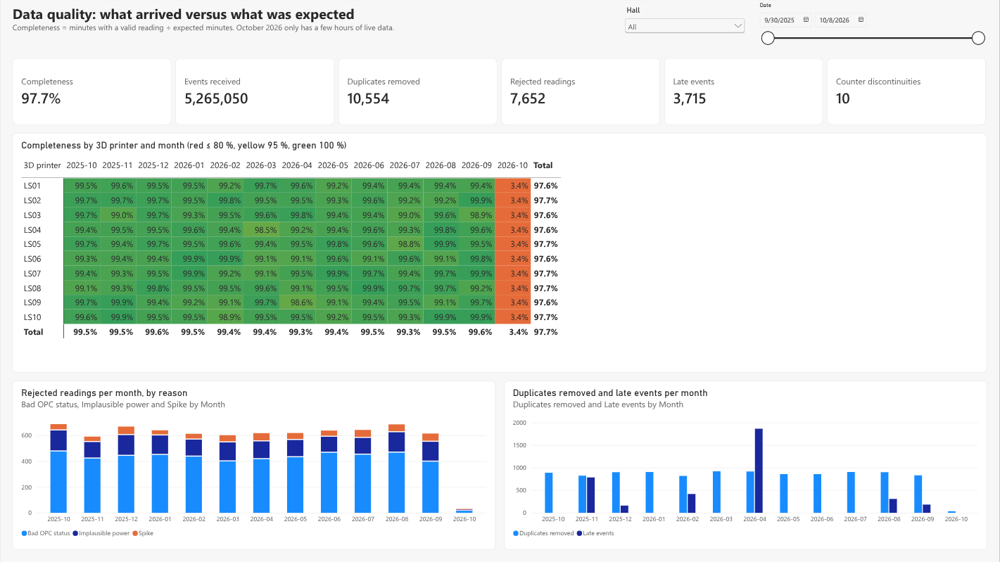](docs/screenshots/05-data-quality.png) **Data quality:** what arrived versus what was expected | [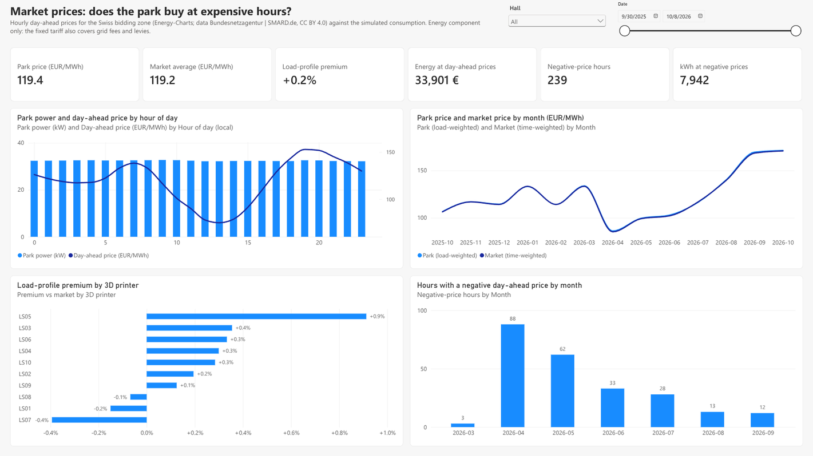](docs/screenshots/06-market-prices.png) **Market prices:** the park's consumption against hourly day-ahead prices |

All six pages as a PDF: [docs/rpt_am_energy.pdf](docs/rpt_am_energy.pdf). A one-page summary of the project:
[docs/portfolio-summary.pdf](docs/portfolio-summary.pdf).

## Architecture

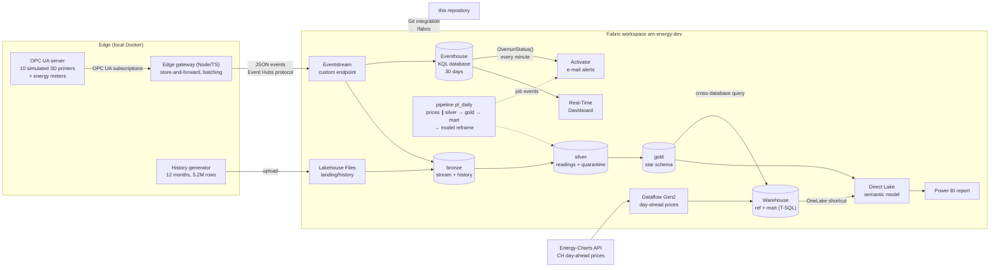

What the workspace looks like in Fabric's lineage view:

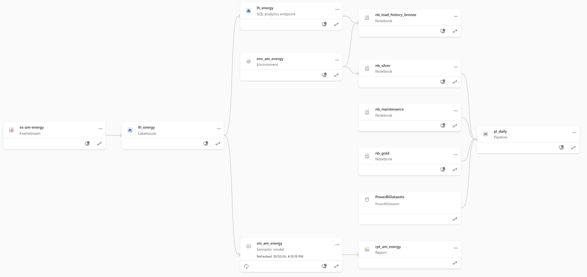

The daily pipeline: the day-ahead prices (Dataflow Gen2) load in parallel with silver; gold follows silver; the
Warehouse mart (stored procedure) waits for gold and the prices; table maintenance runs after gold, and the
semantic model is reframed once, at the end.

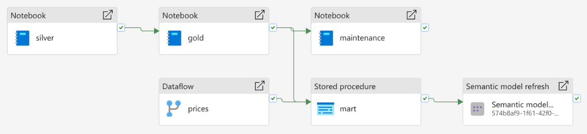

## What it demonstrates

**Streaming and ingestion**
- Eventstream custom endpoint fed by a gateway speaking the Event Hubs protocol (AMQP), with the meter as partition key
  so each meter's events stay in order.
- At-least-once delivery handled downstream: per-meter sequence numbers at the edge, deduplication on the natural key
  (meter, measurement time) in silver.
- Network outages simulated at the gateway: the backlog is replayed after live data, so events arrive late and out of
  order on purpose.
- History backfill from Parquet files with two schema versions (`mergeSchema`), as a full load and incrementally with a
  file-time watermark.

**Lakehouse and transformations**
- One Lakehouse with `bronze`, `silver` and `gold` schemas; bronze keeps data as received.
- Silver with Spark Structured Streaming (`availableNow` plus a checkpoint, so each run processes only new rows),
  quality rules with a quarantine table and a reason per rejected row, and an idempotent insert-only MERGE.
- Gold star schema rebuilt in full on each run: energy from the meters' kWh counters (not integrated power),
  proportional allocation to 15-minute buckets, a time-of-use tariff in local time across daylight-saving changes,
  machine states, build jobs and heat-ups, and an SCD type 2 machine dimension (a hall move and a meter swap).
- Plausibility rules for meter counters: a meter swap restarts near zero; a jump no 3D printer could draw is a
  discontinuity, not energy.

**Semantic model and report**
- Direct Lake on OneLake model over gold: 13 many-to-one relationships, a marked date table, measures with display
  folders and formats; columns for slicing, measures for numbers.
- Data completeness computed against an expectation stored in a coverage grid (one row per machine version and day),
  so it stays correct when a 3D printer changes halls.
- Five report pages in one consistent layout. Two were first built by hand in the browser; all five are stored as
  PBIR JSON, validated against Microsoft's schemas and deployed from Git.
- Row-level security roles by hall (enforcement is an open point, see below).

**Real-time analytics and alerting**
- The Eventstream fans out to an Eventhouse next to the Lakehouse: seconds for "what is happening now", the
  Lakehouse for the history (30 days' retention in the Eventhouse, 7 in hot cache).
- Deduplication in a materialized view, on the same key as silver. Stored KQL functions, versioned in
  [`kql/setup.kql`](kql/setup.kql): current state per 3D printer, state runs with window functions (`prev`,
  `row_cumsum`), heat-ups and overruns, park power in tumbling windows, and freshness (p50 2.5 s and p95 3.6 s from
  measurement to Eventstream).
- A Real-Time Dashboard refreshed every 30 seconds.
- Activator alerts by e-mail: heat-up overruns from a KQL query with a transition condition (one e-mail per overrun;
  a first version on the raw stream sent one per event), and failed `pl_daily` runs from Fabric job events.
- A demo mode (30 times faster, more overruns) kept out of the history by pausing the Lakehouse destination.

| | |
|---|---|
| [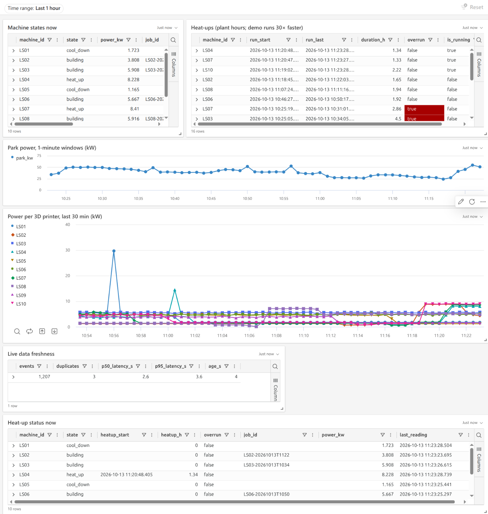](docs/screenshots/12-real-time-dashboard.png) **Real-Time Dashboard** during the demo: states, heat-ups and overruns, park power, freshness | [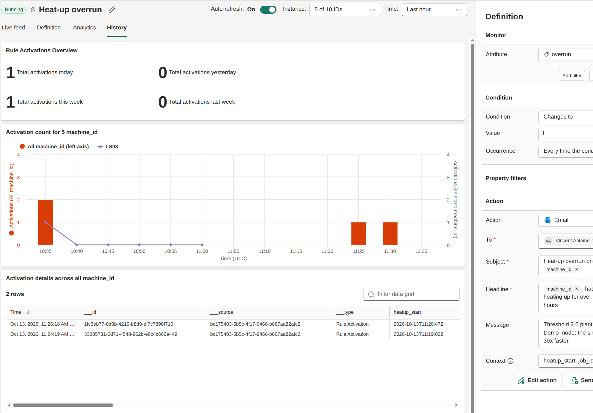](docs/screenshots/13-activator-heat-up-alert.png) **Heat-up alert in Activator:** one activation, and one e-mail, per overrun |

**Market prices: Dataflow Gen2 and a Warehouse**
- A Dataflow Gen2 (Power Query) loads hourly Swiss day-ahead prices from a public REST API into a Warehouse table:
  a static base URL with `RelativePath` and `Query`, so the service can refresh it; staging and a fixed schema, as
  the Warehouse requires.
- T-SQL in the Warehouse: a stored procedure rebuilds the hourly cost mart in one transaction, reading gold through a
  cross-database query. The Warehouse is versioned in Git as a SQL database project;
  [`warehouse/setup.sql`](warehouse/setup.sql) is the readable source.
- A OneLake schema shortcut exposes the mart in the Lakehouse, so the Direct Lake model keeps one source, and the
  hall roles reach the new table through `machine_sk`.
- What it shows: the park pays the market average (+0.2 %), because builds run around the clock. The market is
  cheapest at 13:00 (solar) and dearest at 19:00, while the fixed tariff's peak window is weekdays 07:00 to 20:00;
  239 hours had negative prices, mostly in spring.

**Platform and operations**
- Paid F4 capacity created and paused by script, with a cost budget; Spark pool sized for F4 (one node per session)
  after hitting the capacity's Spark limit.
- Environment with the project's own wheel, Spark Runtime 2.0.
- Pipeline with retries, a shared high-concurrency Spark session, the workspace id passed as a parameter, a daily
  schedule, and an explicit reframe of the semantic model at the end.
- Table maintenance: OPTIMIZE with V-Order for append-heavy tables (the live table went from about 400 small files to
  1) and VACUUM with 7 days' retention.
- Workspace, Spark settings, GitHub connection and Git link created through the Fabric REST API.
- CI on GitHub Actions: the TypeScript and Python tests (the end-to-end ones on a regenerated history), ruff, and a
  check that every field the report uses exists in the semantic model.

## Results, checked against the ground truth

The history generator records every fault it injects in `data/history/ground_truth.json`. Local end-to-end tests and
the Fabric run compare the pipeline's output with it.

| Injected into the data | What the pipeline does | Result |
|---|---|---|
| 10,522 duplicate events | Deduplicates on (meter, measurement time), first arrival wins | Exactly 10,522 removed; every measurement kept once |
| Gateway outages (late, out-of-order replay) | Flags events that arrive more than 5 minutes late | 3,715 late events flagged, all kept |
| Bad OPC status, implausible power, spikes | Quarantine with a reason | 7,652 readings rejected, by reason on the quality page |
| Meter dropouts | State "unknown"; energy still known from the kWh counter | Energy conserved per meter (local test) |
| Meter swap with a counter reset | New counter value counted from zero | Swap detected once, at the right time |
| Live simulator restarting every counter | Treated as a discontinuity, energy unknown | 10 discontinuities instead of 217,000 kWh of phantom energy |
| 108 over-long heat-ups | Overrun = longer than 2.6 h; heat-ups hidden by a gap are not judged | 100 found, 0 false alarms. The 8 missed ones lasted 2.3–2.6 h, inside the normal range: a limit of the simulated data, kept visible rather than tuned away |
| A 3D printer moving halls | SCD type 2 machine dimension | Energy before the move stays with hall 1 |

## Design decisions

All 44 are in [docs/decisions.md](docs/decisions.md), each with the reason and the alternative. A few that shape the
project:

- **Custom endpoint, not MQTT** (1): GA, no public broker, standard Event Hubs SDK.
- **Live data first after an outage** (5): a current dashboard, at the price of late arrivals the pipeline handles.
- **Insert-only MERGE in silver** (8): replays and re-runs are harmless.
- **Energy from counter deltas** (9) and **plausibility checks on counter jumps** (28).
- **Transformations as a tested package** (15), deployed as a wheel to a Fabric Environment.
- **Structured Streaming for silver, not a materialized lake view** (22): MERGE and cross-batch context.
- **Gold rebuilt in full** (23): trivially correct at this volume; recompute touched days if it grows.
- **Explicit reframe of the Direct Lake model** (29): reports never mix new facts with old dimensions.
- **Coverage grid for data quality** (30): completeness stays right when machines change halls.
- **Hot path in an Eventhouse** (33), deduplicated like silver (34).
- **Alerts on transitions, not states** (37): one e-mail per heat-up overrun instead of one per event.
- **Mart in a Warehouse, shortcut into the Lakehouse** (40, 41): a T-SQL transaction, no copy, one model source.

## Rebuild it

What's needed: Docker, Node 22, `uv`, Java 17 or later (for local Spark tests), the Azure CLI, an Azure subscription
and a Microsoft Entra tenant where you are Fabric administrator, and a GitHub fork of this repository.

**Local part (no cloud):**
```bash
cd edge && npm ci && npm test            # 37 tests: simulator, gateway, history generator, demo mode
npm run history                          # 12 months of history into data/history (about 150 MB)
cd ../spark && uv sync && uv run pytest  # 30 tests, including end-to-end runs against the ground truth
cd .. && uvx ruff@0.17.0 check . && python3 scripts/check_fabric.py   # lint; report fields against the model
cd .. && cp .env.example .env && docker compose up --build   # simulator + gateway, writing JSON lines locally
docker compose kill -s USR1 gateway      # toggle a simulated network outage
```

**Fabric part:**
1. `scripts/capacity.sh budget`, then `scripts/capacity.sh create` (F4 in Sweden Central, paused right after).
2. `scripts/capacity.sh resume`, then `scripts/fabric-setup.sh`: creates the workspace on the capacity, sets Spark
   Runtime 2.0 and connects the workspace to `/fabric` of your fork. Needs `GITHUB_PAT` in `.env` (fine-grained, this
   repository only, Contents read and write) and the tenant switch "Users can sync workspace items with GitHub
   repositories".
3. In the workspace: **Source control → Update all**, then publish the Environment `env_am_energy`.
4. Upload the history: `uv run --no-project --with azure-storage-file-datalake --with azure-identity python scripts/upload_history.py`.
5. Run `nb_load_history_bronze`, then `pl_daily`.
6. For live data: copy the Eventstream custom endpoint's connection string into `.env` with `SINK=eventhubs`, then
   `docker compose up`.
7. Real-time path: with the Eventhouse `eh_am_energy` receiving the stream into `meter_events`, run
   `python3 scripts/kql.py mgmt @kql/setup.kql` (set `KUSTO_URI` to the Eventhouse's query URI). For a demo with
   alerts within minutes: `scripts/demo.sh start`, then `scripts/demo.sh stop` (decision 36).
8. Market prices: Update from Git (step 3) brings the Warehouse `wh_am_energy` (its SQL project), the Dataflow Gen2
   `df_day_ahead_prices` and the Lakehouse shortcut `mart`. [`warehouse/setup.sql`](warehouse/setup.sql) recreates
   the Warehouse objects if needed (SQL editor, or `scripts/sql.py` with `WAREHOUSE_SERVER` set); the Dataflow's
   query is in [`dataflow/day_ahead_price.pq`](dataflow/day_ahead_price.pq).

**What isn't automated yet (honest list):** a new workspace has new item ids, so these need rebinding by hand: the
notebooks' default `lakehouse_id` parameter, the Direct Lake source in `expressions.tmdl`, the pipeline's semantic
model refresh activity (and its connection), the Eventstream key, the Real-Time Dashboard's data source, the
Activator's sources and e-mail recipient, the Lakehouse shortcut's target, and the pipeline's Dataflow and
stored-procedure activities. In production these would come from a Variable Library or deployment rules
(fabric-cicd).

## Costs

The Fabric trial wasn't available for a brand-new tenant, so the project runs on a paid **F4** capacity
(pay-as-you-go, €0.67 per hour at list price in Sweden Central), resumed only while working: 19.5 hours over six
working days. Billed so far: **€21** (Azure Cost Management, 1–20 October 2026), nearly all of it capacity usage;
OneLake storage costs cents. The €8 above 19.5 hours at list price comes from pausing: Fabric smooths background jobs
(Spark, Eventstream, Eventhouse) over the following 24 hours, and a pause bills the smoothed usage still outstanding
at once. Pausing still pays: the capacity running around the clock would cost about €480 a month. A paused capacity
also means the daily schedule fails at night: the failed runs show in the Monitoring hub. Activator runs on the
capacity too, so those night-time failures are not e-mailed; failures while the capacity runs are (decision 38).

## Limits, and what production would add

- **Simulated data:** the faults are realistic in kind, not in proportion to any real plant.
- **Row-level security** by hall is defined but not enforced end to end: the model reads OneLake with single sign-on,
  so it would need a fixed-identity connection (or OneLake security) before giving report users access.
- **Edge:** in production, OPC Publisher or Azure IoT Operations into Event Hubs over private networking, with a
  managed identity instead of a SAS key.
- **Platform:** a capacity sized from the Capacity Metrics app and running continuously; dev and prod workspaces with
  deployment pipelines or fabric-cicd from GitHub Actions; a service principal or workspace identity instead of a
  personal OAuth connection; alerts to an on-call channel rather than one mailbox.
- **Real time:** the dashboard shows raw power values, including the spikes that silver quarantines, and the overrun
  alert is evaluated once a minute. Tiles and alert query are set to the demo time scale (`scale` 0.0333); outside a
  demo the heat-up rule is stopped, and a dashboard parameter for the scale would make this a single switch.
- **Market prices:** the day-ahead price is the energy component only; a full dynamic-tariff comparison would need a
  model of grid fees and levies.
- **Scale:** gold would recompute only the days touched by new data instead of rebuilding in full.

## DP-700 skill mapping

| Skill area | Covered here | Next |
|---|---|---|
| Implement and manage an analytics solution | Workspace and Spark settings, Environment, Git integration, pipeline orchestration, schedule and parameters, semantic model security roles, capacity management, OneLake shortcuts, Warehouse as a SQL database project, CI on GitHub Actions | Deployment pipeline or fabric-cicd, workspace roles and item permissions |
| Ingest and transform data | Eventstream, Spark Structured Streaming, PySpark and Spark SQL, full and incremental loads, deduplication, late and missing data, SCD type 2, windowing in Spark, Eventhouse and KQL (materialized view, window functions, stored functions), Dataflow Gen2 (Power Query, web API), T-SQL in a Warehouse (stored procedure, transaction, cross-database query) | A materialized lake view |
| Monitor and optimize | Monitoring hub, Eventstream data insights, OPTIMIZE / V-Order / VACUUM, Spark pool sizing and high concurrency, Direct Lake framing, Activator alerts on pipeline failures (job events) and heat-up overruns (KQL) | Capacity Metrics app |

## Repository layout

| Path | Contents |
|---|---|
| `config/` | Simulation assumptions (power, timing, fault rates) |
| `edge/` | TypeScript: OPC UA simulator, edge gateway, history generator, shared event schema |
| `spark/` | Silver and gold transformations as a Python package, tested locally |
| `fabric/` | Fabric item definitions written by Git integration: notebooks, pipeline, Environment, Eventstream, Lakehouse, semantic model (TMDL), report (PBIR), Eventhouse, Real-Time Dashboard, Warehouse (SQL project), Dataflow Gen2. The Activator is kept out (its definition holds an e-mail address) |
| `warehouse/` | Warehouse setup in T-SQL: schemas, the hourly cost mart, its stored procedure, a view |
| `dataflow/` | Power Query of the Dataflow Gen2 that loads the day-ahead prices |
| `kql/` | Eventhouse setup: retention, the deduplicating materialized view, the real-time functions |
| `model/` | Star schema and DAX measures, as designed before building |
| `scripts/` | Capacity, workspace and Git setup; history upload; demo mode; KQL and T-SQL clients; Fabric definition checks |
| `.github/workflows/` | CI: tests, lint and definition checks on every push |
| `docs/` | Design decisions, screenshots, report PDF |

## Status

| Phase | What | State |
|---|---|---|
| 0 | Everything that runs without Fabric | ✅ |
| 1 | Fabric platform: capacity, workspace, Git integration | ✅ |
| 2 | Ingestion: live stream and history into bronze | ✅ |
| 3 | Silver and gold, orchestration, table maintenance | ✅ |
| 4 | Direct Lake semantic model and Power BI report | ✅ (RLS enforcement open) |
| 5 | Eventhouse/KQL, Real-Time Dashboard and Activator alerts; Dataflow Gen2 and Warehouse; CI | ✅ |
| 6 | Packaging: README, screenshots, demo video | ✅ |

## License

[MIT](LICENSE)
